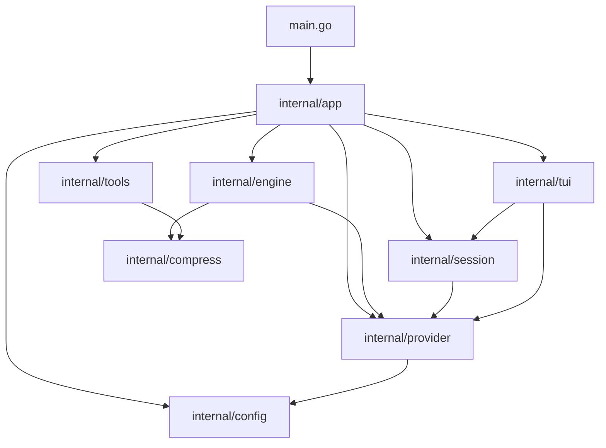

# Eitri architecture

This document maps implementation boundaries for maintainers and agents. User-facing behavior belongs in [README.md](README.md); domain terminology belongs in [GLOSSARY.md](GLOSSARY.md). Detailed operational contracts live under `docs/`.

## Runtime flow

Arrows are imports, abridged: leaf-package edges (`constants`, `osc52`, `skillspack`, `livekey`, `telemetry`, `pulse`, `testutil`) and `tui --> config` are left out. The graph is acyclic and `app` is the only composition root: every other package is handed what it needs rather than constructing it. Note what is absent — the engine reaches the toolset through the injected `ToolExecutor` and takes it as a `[]provider.Tool` manifest, so `internal/tools` never enters the loop.

Startup resolves paths, loads configuration, opens the session store, verifies the declared runtime toolset, materializes builtin skills, and constructs the tool registry, provider, and engine. The app then starts batch mode or the TUI.

One run follows this path:

1. The engine assembles the stable prompt head, skill index, repository instructions, the per-run workspace directive, persisted history, and user prompt — static messages first, per-run state last, so the static prefix stays cacheable.
2. The provider translates canonical messages and tools into its wire dialect and streams the response.
3. Tool calls go through the fixed tool registry and run concurrently within a turn; results are appended in the model's call order. Bash uses bubblewrap by default or the direct backend with `--yolo-unsafe`.
4. Tool output is deterministically compressed before returning to the engine. Older history is compacted with an LLM when context requires it.
5. Typed engine events drive the TUI; requests and responses are appended to the session transcript.

## Package boundaries

### `internal/app`

Composition root. Resolves `EITRI_DIR`, loads config, opens the session store, verifies dependencies, materializes builtin skills, constructs the tool registry/provider/engine, and starts batch or TUI mode. It also owns pprof setup, Copilot login, and session subcommands.

### `internal/config`

Reads and writes the config file it is handed — `<data directory>/config.json` unless `EITRI_CONFIG` overrides it. Defaults include provider `opencode-go`, model `deepseek-v4-flash`, low reasoning effort, thinking enabled, collapsed reasoning/tool results, context-overflow recovery, and 250 maximum turns.

### `internal/engine`

Runs the bounded agent loop. It assembles prompts, streams provider responses, dispatches tool calls through the injected `ToolExecutor`, emits typed events, enforces the turn cap, exposes `ErrStopped`, and retries once after context-overflow compaction. `prompt.md` is embedded at build time; `skillspack/` embeds builtin skills and materializes them under `$EITRI_DIR/skills-builtin`. The read-shape guidance `prompt.md` carries is measured by the [read benchmark](docs/research/read-benchmark-report.html).

### `internal/provider`

Defines canonical messages, tools, streams, usage, and errors. Dialects translate canonical requests and SSE responses to Chat Completions, Anthropic Messages, or OpenAI Responses formats. Adapters implement OpenCode Go, GitHub Copilot, and custom OpenAI-compatible providers. The logging decorator records wire-level data in the session transcript.

### `internal/tools`

Defines `bash`, `open_in_browser`, and `skill`. `sandbox.go` runs bash through bubblewrap; `direct.go` runs it directly for `--yolo-unsafe`. `skills.go` discovers and validates project, user, and builtin skills, with project > user > builtin shadowing; the `skill` tool activates a model-invocable skill by name, short-circuiting one whose complete body is already present in the conversation or was already delivered earlier in the turn.

### `internal/compress`

Deterministically bounds tool results by stripping ANSI and applying line and byte limits. It reports dropped output explicitly and never performs model-based compaction.

### `internal/session`

Stores GUID-named, append-only session directories under the data directory. Message transcripts are JSONL records of provider requests and responses; debug mode adds raw HTTP traces.

### `internal/tui`

Bubble Tea terminal UI. It owns the composer, transcript view, right rail, settings, login, help, slash commands, and turn lifecycle. Three seams carry the turn:

- `TurnRuntime` is the only caller-facing seam for a live Run. It dispatches and cancels the Run, drains the FIFO event feed, preserves event order, and rejects stale Run IDs.
- `Transcript` is the sole owner of transcript projection state, receiving typed start, stream, tool, and completion outcomes, and its interface is the only way in: every production file in package `tui` reaches it through an exported member, never a field. The live turn's pulse — the busy flag and its elapsed clock, the spinner and forge frames, the tool-start glint, the idle ember, and the derived `Phase` — is extracted to the `pulse` sub-package; the transcript forwards to it, and the model shares the same instance so the clock and the render cannot drift. Its interface is `Status()` and the `TickBusy`/`TickEmber`/`ArmEmber`/`EndTurn`/`SettleIdleEmber` commands. Geometry still sits behind the transcript interface: it owns how a frame fits the terminal — `Geometry()` reports the frame footprint (pane size, band width, the rail column, and rail visibility), `TranscriptWidth()` the column the history wraps at, `View(band, bandHeight)` composes the whole left surface, and `RailHeight(bandHeight)` and `RailMaxHeight(bandHeight)` answer the rail's row count and the rows its region may show.
- `TurnSession` supplies cancellable execution only.

The TUI never calls a provider: it names provider kinds for the settings UI and receives every turn through the runtime seam. `livekey`, `telemetry`, and `pulse` are already extracted sub-packages; the remaining leaves are tracked in [docs/agents/de-monolith-tui.md](docs/agents/de-monolith-tui.md).

### Small packages

`internal/osc52` writes clipboard escape sequences; `internal/constants` holds cross-layer limits; `internal/skillindex` owns the model-visible skill index block's marker, the activation block's marker, and the active-set context handoff with its per-turn claim dedup, shared by the renderer in `internal/tools` and its consumers in `internal/engine` (compaction, history partitioning, and the dispatch-time activity scan) so the engine need not import `internal/tools`; `internal/testutil` contains shared test helpers. The session temp is *named* by `internal/session` (`Session.TempDir`), *created* by the bash backends on first use, and owned by the tools registry as `TempHost`; the backends and the rail read it.

`internal/tools/memtmp` is the one exception to the package map: it is a `package main` scratch program, not a library, and nothing imports it.

## Invariants

1. Boot verifies every declared runtime tool, so the prompt does not promise unavailable commands.
2. The stable system-prompt head is byte-identical across turns, and the variable workspace directive is a separate message placed after every static system message, so a provider cache breakpoint at the end of the static prefix keeps hitting.
3. Compression bounds tool output deterministically; compaction summarizes older history with a model.
4. User stop is represented by `ErrStopped`, distinct from provider or tool failure.
5. Sessions and transcripts are append-only.
6. Default bash is bubblewrap-confined; `--yolo-unsafe` executes directly and is not represented as sandboxed.
7. TUI rendering uses typed engine events and rejects stale run IDs.
8. The import graph is acyclic and `app` is the only composition root; the engine reaches the toolset through `ToolExecutor`, never through an import.

## Where to start

| Task | Files |
| --- | --- |
| Agent turn loop | `internal/engine/engine.go`, `events.go` |
| Prompt assembly | `internal/engine/prompt.go`, `message_partition.go`, `prompt.md` |
| Provider wire format | `internal/provider/dialect.go`, `chatdialect.go`, `anthropic.go`, `responses.go` |
| Bash execution | `internal/tools/sandbox.go`, `direct.go`, `tool_bash.go` |
| Tool output limits | `internal/compress/compress.go` |
| Sessions/transcripts | `internal/session`, `internal/provider/messagelog.go` |
| TUI turn lifecycle | `internal/tui/turn_runtime.go` (caller seam), `turn_session.go` and `flowrender.go` (implementation), `internal/engine/events.go` |
| Transcript projection | `internal/tui/transcript.go`, `flowrender.go` |
| Skills | `internal/tools/skills.go`, `tool_skill.go`, `internal/skillindex`, `internal/engine/skillspack`, [docs/adr/0003-skill-tool.md](docs/adr/0003-skill-tool.md) |
| Batch contract | [docs/batch-mode.md](docs/batch-mode.md) |
| Session commands | [docs/sessions.md](docs/sessions.md) |
| Render diagnostics | [docs/render-diagnostics.md](docs/render-diagnostics.md) |
| TUI marks and icons | `internal/tui/glyphs.go`, [docs/adr/](docs/adr/) |
