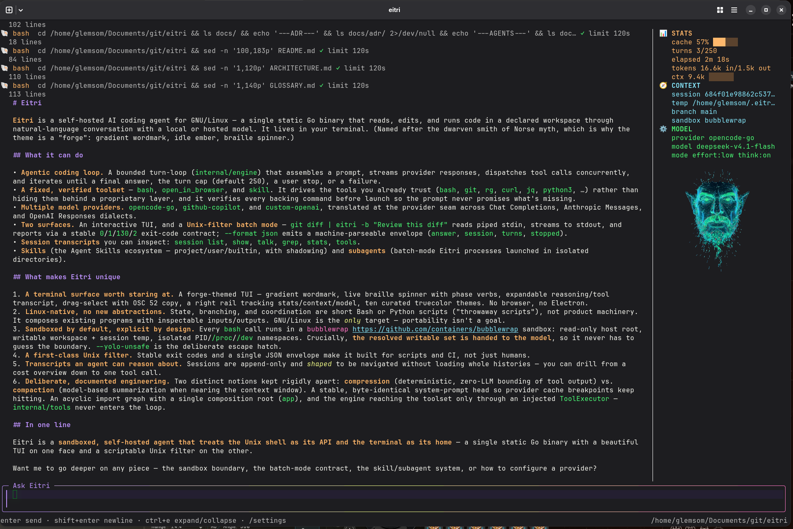

# Eitri

<p align="center">
  
</p>

Eitri is a self-hosted AI coding agent for GNU/Linux — a single static Go binary
that reads, edits, and runs code in a declared workspace through natural-language
conversation with a local or hosted model provider. It is built to feel at home in
your terminal.



## What sets Eitri apart

- **A terminal surface worth staring at.** A forge-themed TUI — gradient wordmark
  with an idle ember, live braille spinner and phase verbs, an expandable
  reasoning/tool transcript, drag-select with OSC 52 copy, and a right rail that
  tracks stats, context, and model as you work. Ten curated themes plus `auto`,
  all truecolor. No browser, no Electron.
- **Linux-native, no new abstractions.** Eitri drives the tools you already trust
  — `bash`, `git`, `rg`, `curl`, `jq`, `python3` — instead of hiding them behind a
  proprietary layer. State, branching, and coordination are short Bash or Python
  scripts, not product machinery.
- **Sandboxed by default, explicit by design.** Every `bash` call runs in a
  bubblewrap sandbox with a read-only host and a writable workspace and session
  temp. The resolved writable set is handed to the model, so it never guesses the
  boundary. `--yolo-unsafe` is the deliberate escape hatch.
- **A first-class Unix filter.** `git diff | eitri -b "Review this diff"` reads
  piped stdin as fenced input, streams the answer to stdout, and reports the
  outcome through a stable `0`/`1`/`130`/`2` exit-code promise; `--format json`
  emits one machine-parseable envelope. Built for scripts and CI.
- **Transcripts an agent can reason about.** Sessions are append-only and shaped
  to be navigated without loading whole histories: `session list`, `show`, `talk`,
  `grep`, `stats`, and `tools` drill from a cost overview down to a single tool
  call.
- **Skills and subagents.** Eitri speaks the Agent Skills ecosystem — project,
  user, and builtin skills behind one invocable `skill` tool — and ships the
  `subagents` and `web-access` builtins.

## Install and run

Install the latest stable release for GNU/Linux `amd64` into `~/.local/bin`:

```sh
curl -fsSL https://raw.githubusercontent.com/glemsom/eitri/main/install.sh | bash
```

For a deterministic installation, pin both the installer source and release archive version:

```sh
curl -fsSL https://raw.githubusercontent.com/glemsom/eitri/v0.1.1/install.sh | bash -s -- --version 0.1.1
```

For the default path, the installer asks the GitHub Releases API for the latest
stable release, then downloads that release's sole versioned
`eitri_<version>_linux_amd64.tar.gz` asset. It does not require `jq`. The installer
prints the `PATH` export to run when `~/.local/bin` is not already on `PATH`; it
never changes shell configuration, prompts, or uses `sudo`.

To build from source, requirements are GNU/Linux, Go, and the [runtime tools](#runtime-requirements):

```sh
make build
./bin/eitri
```

The first launch opens settings for provider and credential configuration. Install a source build with:

```sh
make install                 # installs to ~/.local/bin/eitri
eitri
```

## Usage

```sh
eitri                         # interactive TUI
eitri -b "Review this diff"   # one batch run
git diff | eitri -b "Review this diff"
eitri session list
eitri session show <guid>
eitri session talk <guid>
eitri session grep <pattern> [guid|all]
eitri session stats [guid|all]        # per-session tokens, cache, tool calls, errors
eitri session tools [guid|all]        # every tool call with its result and error tally
eitri --version
```

Batch mode accepts only piped, non-TTY stdin and appends it as fenced context.
Input is limited to 1 MiB and refused, never truncated. `--format json` emits one
object containing `answer`, `session`, `turns`, and `stopped`; `-v` sends reasoning
to stderr. See [docs/batch-mode.md](docs/batch-mode.md) for the input, output, and
exit-code contract.

Useful flags:

| Flag | Purpose |
| --- | --- |
| `-d` | Record full provider HTTP traces in the session. |
| `--yolo-unsafe` | Disable bubblewrap; `bash` runs with the user's full permissions. |
| `--pprof <addr>` | Enable localhost pprof diagnostics. `--pprof-mutex` and `--pprof-block` add profiles. |
| `--format text\|json` | Select batch output format. |

The TUI's `/help` is the authoritative reference for keybindings and slash
commands. `/settings`, `/login`, and `/new` are available there.

## Safety

By default, every `bash` command runs in a bubblewrap sandbox with a read-only
root, writable workspace and session temporary directory, and isolated PID,
`/proc`, and `/dev` namespaces. `--yolo-unsafe` removes the sandbox and must only
be used with trusted prompts and workloads.

The whole host root is bound read-only, so `$HOME` is readable but not writable.
Tools that keep state there — `helm`, `terraform`, `az`, `aws`, `docker` — need
their paths added to `extra_writable_paths` in the config, or the **Writable
paths** field in `/settings`. Eitri tells the model the resolved writable set, so
it stops guessing where the boundary is. See [docs/sandbox.md](docs/sandbox.md)
for the full boundary, the escape hatch, and its sharp edges.

Commands are limited to 120 seconds by default; each call can request up to 3600
seconds.

## Providers and local data

Supported providers are `opencode-go`, `github-copilot`, and `custom-openai`.
Configure the provider, credentials, and model in the TUI's `/settings`;
provider-specific login is available through `/login` where applicable.

Eitri stores configuration, credentials, sessions, transcripts, and materialized
builtin skills under `~/.eitri`. Set `EITRI_DIR` to change the data directory, or
`EITRI_CONFIG` to change the config path (default: `<data directory>/config.json`).
Do not commit the config file.

Sessions are append-only and can be inspected with the `session` commands. See
[docs/sessions.md](docs/sessions.md).

## Skills and workspace instructions

Skills are discovered in project `.agents/skills`, user `~/.agents/skills`, then
builtin skills. A same-named skill in a higher-priority scope shadows
lower-priority scopes. Builtins currently include `subagents` and `web-access`.

Every model-visible skill is announced in a compact catalog that is re-sent each
turn: each skill root is a bracketed heading, and its skills follow as one
`<name>: <description>` line each. The model activates a listed skill with the
`skill` tool, which loads its instructions and absolute directory (a skill already
active in the conversation returns a short note instead of the body). A human can
always force a skill into context with `/skillname`.

An `AGENTS.md` in the workspace root is loaded as repository instructions.

## Build and test

```sh
make build
make test
```

## Runtime requirements

Eitri verifies these commands before starting, unless `--yolo-unsafe` removes the `bwrap` requirement:

`bwrap`, `bash`, `rg`, `curl`, `lynx`, `patch`, `python3`, `git`, `jq`, and `xdg-open`.

Debian/Ubuntu:

```sh
sudo apt install bubblewrap bash ripgrep curl lynx patch python3 git jq xdg-utils
```

Fedora and Arch provide the same package names. Core utilities such as `sed`,
`awk`, and `diff` are assumed.

## Documentation

- [GLOSSARY.md](GLOSSARY.md) — the domain vocabulary.
- [ARCHITECTURE.md](ARCHITECTURE.md) — how the modules are wired.
- `docs/` — operational contracts: [batch mode](docs/batch-mode.md),
  [the sandbox](docs/sandbox.md), [sessions](docs/sessions.md), and
  [render diagnostics](docs/render-diagnostics.md).
- [docs/adr/](docs/adr/) — decisions, including the terminal and icon tiers.

Release maintainers should follow the [release runbook](docs/releases.md).

## License

Eitri is licensed under [GPL-3.0-or-later](LICENSE).
